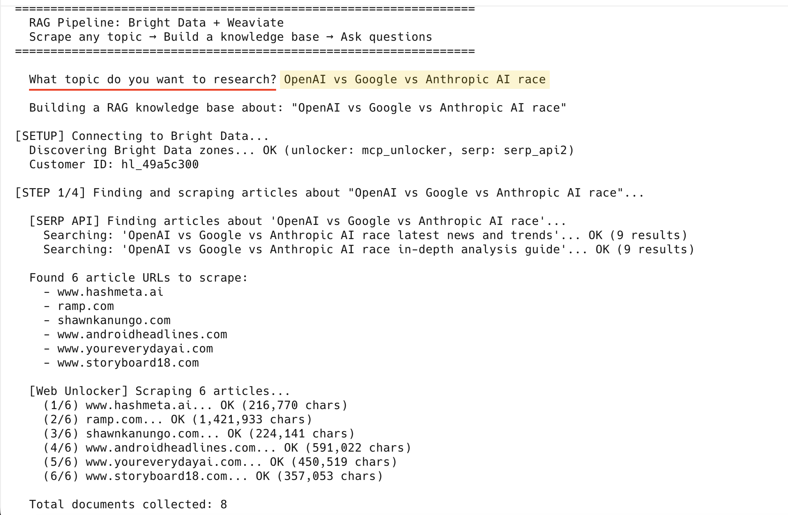

# RAG 流水线：Bright Data + Weaviate

任选一个主题。该流水线会查找相关的真实文章，使用 [Bright Data](https://www.bright.cn/) 抓取文章，将其存储到 [Weaviate](https://weaviate.io/)，并支持你提出问题：答案会注明引用来源，并基于最新抓取的网页数据，而非过时的训练数据。



## 快速开始

**前提条件：**
- Python 3.10+
- 获取 [Bright Data](https://www.bright.cn/cp/setting/users)、[Cohere](https://dashboard.cohere.com/) 和 [Weaviate Cloud](https://console.weaviate.cloud/) 的 API 密钥（均可免费开始使用：请参阅下方的 [API 密钥](#api-密钥可免费开始使用)）

```bash
# 1. Clone and install
git clone https://github.com/bright-cn/weaviate-bright-data-rag.git
cd weaviate-bright-data-rag
pip3 install -r requirements.txt

# 2. Add your API keys
cp .env.example .env
# Edit .env and fill in your keys

# 3. Run it
python3 pipeline.py
```

## 工作原理

```
You enter a topic (e.g. "electric vehicles")
  ↓
Bright Data SERP API → finds top articles about your topic
  ↓
Bright Data Web Unlocker → scrapes those articles (even anti-bot protected sites)
  ↓
Processing → cleans HTML, chunks into ~150-400 chunks with metadata
  ↓
Weaviate Cloud → auto-embeds via Cohere, stores with hybrid search index
  ↓
You ask questions → hybrid search retrieves relevant chunks →
  Cohere generates cited answers from YOUR topic's data
```

## 示例

```
$ python3 pipeline.py

=================================================================
  RAG Pipeline: Bright Data + Weaviate
  Scrape any topic → Build a knowledge base → Ask questions
=================================================================

  What topic do you want to research? OpenAI vs Google vs Anthropic AI race

[SETUP] Connecting to Bright Data...
  Discovering Bright Data zones... OK (unlocker: mcp_unlocker, serp: serp_api2)

[STEP 1/4] Finding and scraping articles about "OpenAI vs Google vs Anthropic AI race"...
  [SERP API] Finding articles...
    Searching: '... latest news and trends'... OK (9 results)
    Searching: '... in-depth analysis guide'... OK (9 results)
  Found 6 article URLs to scrape:
    - www.hashmeta.ai
    - shawnkanungo.com
    - www.ndtv.com
    ...
  [Web Unlocker] Scraping 6 articles...
    (1/6) www.hashmeta.ai... OK (216,770 chars)
    (2/6) shawnkanungo.com... OK (224,141 chars)
    ...

[STEP 2/4] Processing and chunking documents...
  Created 270 chunks from 8 documents

[STEP 3/4] Storing in Weaviate (embedding + indexing)...
  Imported: 270 success, 0 failed

[STEP 4/4] RAG queries about "OpenAI vs Google vs Anthropic AI race"...

  Q: What are the latest developments and trends in ...?
  A: The AI race among OpenAI, Google, and Anthropic continues to
     evolve rapidly, with each company leveraging unique strengths...

  Sources (5 chunks retrieved):
    - [shawnkanungo.com] https://shawnkanungo.com/blog/...
    - [www.hashmeta.ai] https://www.hashmeta.ai/en/blog/...

  Your knowledge base about "OpenAI vs Google vs Anthropic AI race" is ready!
  Ask anything. Type 'quit' to exit.

  Your question: _
```

## API 密钥（可免费开始使用）

| 服务 | 获取方式 | 免费套餐 |
|---------|-----------|-----------|
| [Bright Data](https://www.bright.cn/cp/setting/users) | 注册 → 账户设置 → API 密钥 | 免费试用额度 |
| [Cohere](https://dashboard.cohere.com/) | 使用 Google、GitHub 或电子邮箱注册 → 复制试用 API 密钥 | 有速率限制的试用套餐（无需信用卡） |
| [Weaviate Cloud](https://console.weaviate.cloud/) | 注册 → 创建集群 → 沙盒（免费） | 免费沙盒（14 天后到期，可随时重新创建） |

## 许可证

MIT
